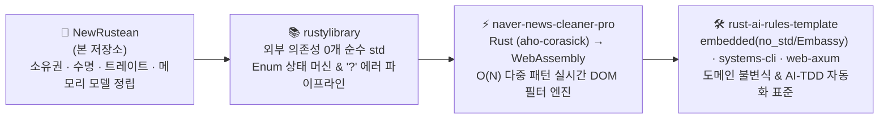

# 🦀 NewRustean — Rust 시스템 프로그래밍 핵심 개념 학습 & 레퍼런스 아카이브

[](https://www.rust-lang.org)
[](./README.md)

> **GC(가비지 컬렉터) 없는 메모리 안전성, 소유권·수명(Ownership & Lifetimes), 제로 코스트 추상화, 안전한 동시성 모델을 체화하기 위해 시작한 Rust 시스템 프로그래밍 학습 레퍼런스 보관소입니다.**

---

## 1. Why — 배경 및 해결하려는 문제

C/C++ 및 매니지드 언어(C#, Python, Kotlin) 환경에서 시스템·네트워크 소프트웨어를 다루다 보면 **런타임 가비지 컬렉션 지터(GC Pause)**와 **수동 메모리 관리로 인한 데이터 레이스·댕글링 포인터 위험** 사이의 트레이드오프에 직면하게 됩니다.

Rust는 컴파일 타임 대여 검사기(Borrow Checker)와 타입 시스템을 통해 두 문제를 동시에 해결하지만, 소유권 이동(Move), 라이프타임 표기, 트레이트 경계 등 초기 학습 장벽이 높습니다. 본 저장소는 반복적인 시행착오 끝에 Rust의 핵심 멘탈 모델을 정립하기 위한 기준 레퍼런스를 모아두고, 이후 실제 크레이트·WebAssembly·임베디드 규칙 프로젝트로 확장해 나간 출발점 아카이브입니다.

---

## 2. What — 보관 자료 및 중점 학습 범위

현재 저장소에는 시스템 프로그래밍 관점의 Rust 심화 서적인 **`Programming Rust, 2nd Edition.pdf`** 원문 레퍼런스가 수록되어 있으며, 아래 4대 핵심 축을 중심으로 후속 실전 저장소들과 연결됩니다.

1. **메모리 레이아웃 & 소유권 모델 (`Ownership, Moves & Lifetimes`)**: 스택/힙 배치 결정론, 참조 대여 불변식(`&T` XOR `&mut T`), 수명 엘ision 규칙.
2. **타입 시스템 & 제로 코스트 추상화 (`Enums, Pattern Matching & Traits`)**: 대수적 자료형(`enum`)을 통한 불법 상태 원천 차단, `From`/`FromStr`/`Display`/`Error` 표준 트레이트 조합.
3. **시스템 I/O & 동시성 (`Send` / `Sync`, Lock-Free & Async Runtime)**: 스레드 간 데이터 레이스를 컴파일 타임에 차단하는 마커 트레이트 구조와 비동기 태스크 모델.
4. **타겟 확장 (`WebAssembly & Embedded no_std`)**: `cdylib` 기반 브라우저 `wasm32-unknown-unknown` 바인딩 및 힙 없는 MCU 펌웨어(`no_std`) 아키텍처.

---

## 3. How — 학습 로드맵 및 실전 프로젝트 확장 구조

본 아카이브에서 정립한 언어 기초는 단일 저장소에 머물지 않고 아래와 같이 단계별 실전 Rust 엔지니어링 저장소로 분화·구현되었습니다.



### 연관 실전 Rust 저장소 인덱스

| 단계 | 연결 저장소 | 핵심 적용 기술 |
| :---: | :--- | :--- |
| **Step 1 (Core `std`)** | **[`tejo1990/rustylibrary`](https://github.com/tejo1990/rustylibrary)** | Rust Edition 2024, `BookStatus` 대수적 상태 모델링, `From<E>` 수동 에러 승격, CSV 직렬화/복구 단위 테스트 |
| **Step 2 (`Rust + WASM`)** | **[`tejo1990/naver-news-cleaner-pro`](https://github.com/tejo1990/naver-news-cleaner-pro)** | `rust-core/` 크레이트(`aho-corasick`, `wasm-bindgen`, `opt-level = "z"`, LTO) + Manifest V3 CSP-Safe 선형 메모리 브릿지 |
| **Step 3 (`Domain Engineering`)** | **[`tejo1990/rust-ai-rules-template`](https://github.com/tejo1990/rust-ai-rules-template)** | `embedded`(`no_std`, `Embassy`, `RTIC`, `defmt`), `systems-cli`(`clap`, `Tokio`, `Rayon`), `web-axum` 도메인 규칙 및 Cargo 샌드박스 MCP 서버 |

### 디렉토리 구조

```text
NewRustean/
├── Programming Rust 2nd Edition.pdf   # 시스템 프로그래밍 관점 Rust 핵심 레퍼런스 문서
└── README.md                          # 학습 목적, 핵심 주제 및 후속 실전 크레이트 연결 가이드
```

---

## 4. Quick Start — 로컬 클론 및 Rust 실습 환경 구성

본 저장소는 문서 중심 레퍼런스 아카이브이므로 별도의 빌드 과정 없이 클론 후 열람할 수 있으며, 로컬 Rust 실습 환경을 함께 구성하려면 아래 표준 명령어를 사용합니다.

```bash
# 1. 아카이브 클론
git clone https://github.com/tejo1990/NewRustean.git
cd NewRustean

# 2. (선택) Rust 공식 툴체인(rustup / cargo / clippy / rustfmt) 최신 안정 버전 확인
rustup update stable
rustc --version
cargo --version

# 3. 후속 실전 크레이트(rustylibrary) 바로 실행·검증해 보기
git clone https://github.com/tejo1990/rustylibrary.git ../rustylibrary
cargo test --manifest-path ../rustylibrary/Cargo.toml
```
